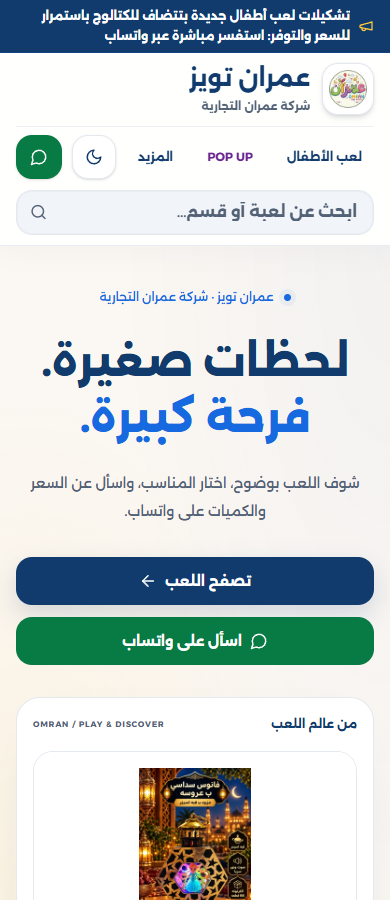

# عمران 2026 — مراجعة الأفكار الإبداعية الخمس

**البرومبت 09 / Phase A — للمراجعة فقط** 
شركة عمران التجارية — OMRAN Toys & Gifts — طنطا 
**تاريخ المراجعة:** 9 نوفمبر 2026 
**المتابعة:** [Issue #180](https://github.com/alaaomran2020/omran-store-live/issues/180)، بعد [تقرير #182](../audits/OMRAN-STORE-AUDIT-CODEX-2026-10-31.md) و[فحص الموبايل الحي](../audits/OMRAN-MOBILE-LIVE-FOLLOWUP-2026-11-09.md).

## 1. القرار المقترح

اعتماد **عمران سيليكت** كأساس لعرض المنتج، مع **عمران يجمعنا** كنظام حملة افتتاح مكمل بعد اعتماد التاريخ وصور الفرع. الأول يسهل رؤية المنتج والاستفسار عنه؛ الثاني يوضح سبب الزيارة ومكانها. يظل البحث والأقسام أدوات خدمة واضحة داخل النظام، دون خلط الزخارف البصرية للاتجاهات الخمسة في صفحة واحدة.

الاختيار المقترح ليس تصميمًا معتمدًا أو تصريح تنفيذ. لا تعديل واجهة أو منتجات أو لوجو أو نشر في هذه المرحلة. البديل الأقرب هو **اختار بسهولة** إذا كانت أولوية صاحب الشركة تنظيم الاكتشاف أكثر من تحسين العرض البصري.

## 2. ما يستند إليه القرار

### حقائق مثبتة

- المستودع الرسمي الحالي main عند `71075393caf3526b700efaae8db3f9f5c778702f`. قرئت تعليمات AGENTS والبرومبتات وbrief الإبداع من فرع PR #179 غير المدموج.
- فُحص الموقع الحي والتُقطت 15 صورة عند 320/360/390، لا نماذج متخيلة. [ملحق الدليل](../audits/OMRAN-MOBILE-LIVE-FOLLOWUP-2026-11-09.md) يشرح المنهج والقيود.
- الكتالوج المقروء يضم 56 منتجًا موسميًا معتمدًا مؤقتًا: 35 فانوسًا و21 منسوجات. لا تتحول إلى تشكيلة ألعاب عامة جديدة بسبب التصميم؛ إعادة تسجيل الأصناف من Egypt System عمل منفصل.
- البحث عن «فانوس» أظهر 31 نتيجة؛ تصنيف المفارش أظهر 21 بطاقة. الأعمار والماركات والخيارات التفصيلية غير متاحة في الإسقاط الحالي كما يهيئه productsClient.
- بطاقات المنتج تعرض صورة واسمًا وكودًا؛ الاستفسار عن السعر والتوفر عبر واتساب. لا أسعار أو خصومات أو تقييمات أو ادعاء «الأكثر مبيعًا».
- صورة الهيرو الأولى تبدأ قرب y=752px عند 390، وقرب y=808px عند 320 بارتفاع 900. تُسبق بعنوان كبير وزرين بارزين؛ تحسين التسلسل فرصة، وليس زيادة تحويل مثبتة.
- في التفاصيل يوجد قص للصورة والنص عند 320/360، ورابط رسالة واتساب من الرئيسية لا يحتفظ بالرابط العميق. هذان عائقان في رحلة البيع يُقترح إصلاحهما قبل توسيع الحملة.
- بيانات الفرعين ظاهرة بوضوح، لكن بطاقتيهما بلا اتجاهات. لم تُثبت ساعات عمل أو إحداثيات أو جاهزية حدث افتتاح.
- **لا توجد نتيجة GSC أو بيانات مبيعات/تحويلات أو مقابلات عملاء**. الاحتياجات والتأثير التجاري أدناه فرضيات مهنية قابلة للتحقق.

### خط الأساس المرئي

الصورة توضح الهوية الحالية ووزن النص وتأخر المنتج. لا تُستخدم لقطة الشاشة كإعلان أو كأصل منتج بديل.

### المراجع التنفيذية

[Storefront](https://github.com/alaaomran2020/omran-store-live/blob/71075393caf3526b700efaae8db3f9f5c778702f/client/src/pages/Storefront.tsx)، [HomeHero](https://github.com/alaaomran2020/omran-store-live/blob/71075393caf3526b700efaae8db3f9f5c778702f/client/src/components/HomeHero.tsx)، [HomeCategoryHighlights](https://github.com/alaaomran2020/omran-store-live/blob/71075393caf3526b700efaae8db3f9f5c778702f/client/src/components/HomeCategoryHighlights.tsx)، [ProductCard](https://github.com/alaaomran2020/omran-store-live/blob/71075393caf3526b700efaae8db3f9f5c778702f/client/src/components/ProductCard.tsx)، [ProductDetailsDialog](https://github.com/alaaomran2020/omran-store-live/blob/71075393caf3526b700efaae8db3f9f5c778702f/client/src/components/ProductDetailsDialog.tsx)، [HomeSupportSections](https://github.com/alaaomran2020/omran-store-live/blob/71075393caf3526b700efaae8db3f9f5c778702f/client/src/components/HomeSupportSections.tsx)، [productFormat](https://github.com/alaaomran2020/omran-store-live/blob/71075393caf3526b700efaae8db3f9f5c778702f/client/src/lib/productFormat.ts)، [index.css](https://github.com/alaaomran2020/omran-store-live/blob/71075393caf3526b700efaae8db3f9f5c778702f/client/src/index.css) و[design-system.css](https://github.com/alaaomran2020/omran-store-live/blob/71075393caf3526b700efaae8db3f9f5c778702f/client/src/design-system.css).

لا يوجد Home.tsx كمدخل فعلي في النسخة المفحوصة؛ تُبنى المواصفات على المكوّنات الموجودة دون إعادة معمارية.

## 3. هوية ثابتة وحدود الصور

### مرجع الأصول

| الأصل | ما تحقق | الاستخدام المسموح في المقترح |
| --- | --- | --- |
| public/brand/logo.png | أصل 512×512 PNG، فُتح وفُحص؛ نفس الشعار الظاهر في المتجر | استخدامه كما هو دون إعادة رسم أو تغيير ألوان أو تمديد |
| public/brand/logo-96.webp | نسخة معتمدة 96×96، يستخدمها الهيدر | مرجع للعرض الصغير؛ لا تكبيرها لأعمال طباعة |
| ramadan-fanous-035.jpg | 1024×1536، مرتبط بـOMR-RAM-2026-035؛ صورة منشورة ذات معالجة/كتابات أصلية | عرض كامل داخل إطار؛ ليست صورة استوديو نظيفة ولا تصريحًا بمحو المعلومات منها |
| ramadan-0034-main.webp | 1400×1400، طقم مفارش فردية بيج بنقوش ذهبية OMR-RAM-0034 | مرشح بديل لعرض مربع بعد اعتماد استخدامه في المادة |
| صور الفرع/العائلة | لم يتحدد أصل معتمد مصنف لهذا الغرض في فهرس المستودع المقروء | متطلب تصوير/اعتماد؛ لا صورة مخزون عامة أو مولدة تُقدَّم كواقع الفرع |

روابط الصور الأصلية: [الفانوس](https://github.com/alaaomran2020/omran-store-live/blob/71075393caf3526b700efaae8db3f9f5c778702f/public/products/processed/ramadan/ramadan-fanous-035.jpg)، [المفارش](https://github.com/alaaomran2020/omran-store-live/blob/71075393caf3526b700efaae8db3f9f5c778702f/public/products/processed/ramadan/ramadan-0034-main.webp)، [اللوجو](https://github.com/alaaomran2020/omran-store-live/blob/71075393caf3526b700efaae8db3f9f5c778702f/public/brand/logo.png).

هذه أمثلة من النشر الحالي وليست إثبات مخزون متاح أو اعتماد حملة جديدة. يُعاد تأكيد السلعة والصورة وحق استخدامها قبل النشر؛ لا نقل منتجات متقاعدة أو صور POP UP إلى كتالوج عمران.

### ألوان وخط: تعارض يجب إدارته

| المجال | التنفيذ الحالي المقروء | قرار المراجعة |
| --- | --- | --- |
| الأزرق/الكحلي | #1769E0 / #123B6D | الهيكل الثابت للاتجاهات الخمسة |
| الأحمر/الأصفر | #C62828 / #FFC83D | مساحات صغيرة؛ لا تنبيه لخصم أو ندرة غير مثبتة |
| السطح/الخلفية | #FFFFFF / #FBF7F2 | مرجع المقترح الحالي؛ لا استبدال صامت بـ#F7F9FC الأقدم |
| النص/الثانوي | #10233F / #526176 | القراءة قبل الزخرفة |
| واتساب | #087A43؛ hover #066838 | للاستفسار فقط؛ لا رجوع تلقائي لأخضر #25D366 القديم |
| الخط | CSS وتحميل الخط: Alexandria؛ مستندات التنفيذ والتعليمات: Cairo | أولوية التنفيذ الحالي محفوظة. تستخدم المواصفات token الخط الفعلي، ويُحسم التعارض قبل الإنتاج؛ لا استيراد أو تبديل خط هنا |

لا نغير ألوان الشعار لتطابق هذه اللوحة. الشعار متعدد الألوان يبقى كما هو، فوق مساحة هادئة تضمن ظهوره. مقترح safe area: مساحة محايدة حوله لا تقل عن padding موضعه، مع اعتماد بصري لكل حجم؛ ليس هذا إنشاء نسخة جديدة من دليل الشعار.

**قواعد مشتركة:** RTL، ثلاث مراتب نص كحد أقصى في المادة، صورة حقيقية، معلومة موثقة، فعل رئيسي واحد في كل مشهد. روابط البحث والأقسام أدوات تنقل؛ لا تتحول إلى أزرار ترويجية متنافسة. لا يُطبع عمر أو ميزة أو محتوى علبة إلا إذا وُثق للسلعة نفسها.

## 4. الاتجاه الأول — عالم عمران | نوافذ الاكتشاف

**الاستعارة:** واجهات عرض تفتح على أقسام حقيقية. كل نافذة طريقة لاكتشاف الموجود، وليست عالمًا خياليًا يستبدل البضاعة.

**الجمهور والمشكلة:** زائر يعرف المناسبة ولا يعرف اسم المنتج. الفرضية أنه يحتاج مدخلين واضحين بدل لافتة عامة طويلة؛ المتاح حاليًا فوانيس ومفارش فقط.

**الإخراج البصري:** إطارات كحلية منتظمة، خلفية محايدة، مساحة صفراء صغيرة تحدد النافذة المختارة. لا شخصيات كرتونية إضافية أو قصاصات أو انفجارات ألوان.

**التكوين:** نافذتان صغيرتان للقسمين، ثم منتج حقيقي واحد واضح واسم مختصر وكود. على الموبايل تُكدّس الوحدات بترتيب قراءة RTL، ولا يوضع العنوان فوق الصورة. لا شبكة أقسام غير متاحة.

**الخط واللون:** token الخط الحالي؛ عنوان 700، نص 400–600؛ الأزرق للحركة والكحلي للقراءة. الأحمر اختياري في تفصيل واحد لا في زر ثانٍ.

**الصور:** صورة كل قسم المعتمدة وصورة المنتج الأصلية، كاملة داخل الإطار. لا صناعة مجموعة منتجات من صور لا تخص مخزونًا منشورًا.

**نسخة مقترحة:** «ابدأ بالقسم اللي محتاجه.» ثم اسم المنتج الحقيقي. في مادة المنتج تكون الدعوة «اسأل عن السعر والتوفر».

**الأثر العاطفي:** فضول مع شعور بالترتيب. **المنطق التجاري:** توجيه الزيارة إلى قسم/منتج محدد، وتقليل الاستفسار العام غير المرتبط بكود.

**التطبيقات وإعادة الاستخدام:** مدخل الأقسام، غلاف ألبوم منتجات، نهاية Reel من صور حقيقية. يبقى نظام الإطار ثابتًا ويتغير المحتوى المعتمد فقط؛ لا تغيير صور الأصول لتلائم الإطار.

**الخطر والضبط:** قد يضيف ازدحامًا فوق الهيدر الطويل. حد أقصى نافذتان في أول مشهد، ومنتج واحد في المادة؛ لا خلفيات تتنافس معه.

**اختبار الفرضية:** راقب الانتقال من مدخل القسم إلى منتج، وقدرة المستخدم على تسمية اختياره بعد نظرة قصيرة؛ لا أرقام تحسن مفترضة.

## 5. الاتجاه الثاني — عمران سيليكت | المنتج قبل الكلام

**الاستعارة:** منصة عرض موثوقة تعرض الشيء كما هو، وكأن البائع وضعه أمام العميل وترك له مساحة يراه فيها.

**الجمهور والمشكلة:** مشتري يريد التأكد مما يسأل عنه، أو تاجر يريد صورة وكودًا واضحين. الدليل: الصورة متأخرة في الهيرو، والتفاصيل تقص بعض المحتوى على الشاشات الصغيرة.

**الإخراج البصري:** مساحة محايدة هادئة، إطار رفيع، صورة كاملة بلا قص زينة إضافي، وكود يمكن قراءته. الراحة والدقة أساس الجودة؛ لا «فخامة» توحي بخامة أو حجم غير موثق.

**التكوين:** صورة → اسم حقيقي → كود/معلومة واحدة موثقة → زر واتساب. في المادة الاجتماعية تشغل الصورة 60–70% من المساحة؛ ترتيب مراتب النص ثابت.

**الخط واللون:** الكحلي للاسم، اللون الثانوي للتوضيح، الأخضر للفعل الوحيد. token الخط الحالي؛ عنوان 700 ونص 400–600، مع اختبار النص الطويل عند 320.

**الصور:** يمكن بدء المراجعة بالصورة المنشورة كاملة داخل إطار؛ لا نقدمها على أنها لقطة استوديو جديدة. عند توافر تصوير نظيف معتمد، يستبدل موضع الصورة دون تغيير النظام. لا تنظيف يخفي عبوة أو ملحقًا أو كتابة جوهرية.

**نسخة مقترحة:** «شوفه بوضوح… واسألنا عن اختيارك.» بجوار «فانوس سداسي بعروسة» وكوده. لا تكرار «وصل جديد» دون تاريخ استلام موثق.

**الأثر العاطفي:** وضوح واطمئنان. **المنطق التجاري:** إرسال استفسار مرتبط بسلعة ورابط صحيحين، وتقليل الرسائل اللاحقة لتحديد المقصود.

**التطبيقات وإعادة الاستخدام:** هيرو المنتج، بطاقة العرض، تفاصيله، Product Spotlight مربع أو 4:5. يمكن توسيعه لأصناف جديدة بعد اعتمادها من Egypt System، دون إعادة تصميم كل فئة.

**الخطر والضبط:** قد يبدو باردًا إذا غابت شخصية عمران؛ يعالج بمسافة مدروسة ولمسة صفراء صغيرة ولغة مصرية مباشرة، لا بزخارف فوق الصورة.

**شرط ما قبل التنفيذ:** إصلاح قص التفاصيل ورابط الاستفسار في مهمتين صغيرتين منفصلتين. التصميم لا يخفي الخلل الوظيفي.

**اختبار الفرضية:** هل يمكن للعميل رؤية المنتج كاملًا وقراءة الكود والوصول إلى الاستفسار دون بحث؟ القياس اللاحق: مشاهدة منتج → نقرة استفسار؛ النقرة ليست بيعًا مؤكدًا.

## 6. الاتجاه الثالث — فرحة كل بيت | لحظة الاختيار والإهداء

**الاستعارة:** لحظة تقديم اختيار حقيقي لشخص آخر، لا مشهد عائلي عام يوهم أنه يثبت جودة السلعة.

**الجمهور والمشكلة:** أسرة تريد هدية لها معنى وتحتاج مساعدة بشرية. هذا احتياج مفترض؛ لا توجد مقابلات عملاء تثبته في هذه الجولة.

**الإخراج البصري:** دفء ضوء طبيعي، تفاصيل يد/تغليف السلعة الحقيقية إذا كانت مصورة ومصرحًا بها، ثم المنتج نفسه. لا وجوه مجهولة تُعرض كتوصيات عملاء.

**التكوين:** صورة المنتج أولًا، لقطة سياق ثانوية عند توافرها، جملة وجدانية واحدة، فعل واحد. لا نص فوق وجه أو جسم المنتج. إذا غابت صورة الأسرة المعتمدة لا تُنتج نسخة توهم بوجودها؛ يُحفظ الاتجاه كمتطلب تصوير.

**الخط واللون:** نفس الأزرق والكحلي، مع أصفر هادئ في مساحة صغيرة. لا إضافة palette بنية أو وردية كاملة؛ الخط الحالي بمساحات مريحة ودرجات محدودة.

**الصور:** تصوير حقيقي بحقوق استخدام ومطابقة للمنتج/العبوة. لا طفل يحمل لعبة مختلفة، ولا استنتاج عمر مناسب أو أمان من صورة طفل.

**نسخة مقترحة:** «اختيارك له معنى.» ودعوة «محتاج مساعدة تختار؟ ابعتلنا على واتساب». يُستخدم فعل واحد في المادة؛ لا يضاف زر منتج ثانٍ بنفس القوة.

**الأثر العاطفي:** قرب ودفء ومساعدة. **المنطق التجاري:** نقل العميل المتردد إلى استشارة مفيدة بدل وعد غير موثق بالهدية المثالية.

**التطبيقات وإعادة الاستخدام:** حملة هدايا، قصص سياقية، دليل اختيار بعد توافر بياناته. استخدام موسمي محدود؛ لا يفرض صور أشخاص على بطاقات الكتالوج.

**الخطر والضبط:** كلفة تصوير وحقوق ونماذج، واحتمال صور نمطية. لا شراء تصوير أو تعاقد هنا؛ تسبق الإنتاج قائمة موافقات وتطابق المنتج.

**اختبار الفرضية:** نوعية الاستفسار عن المناسبة والاحتياج، وقدرة فريق البيع على ترشيح أصناف معتمدة. لا تعميم على المبيعات قبل تجربة.

## 7. الاتجاه الرابع — عمران يجمعنا | طريق واضح إلى الفرع

**الاستعارة:** دعوة محلية واضحة تنتهي بزيارة مكان حقيقي؛ العنوان هو جزء من الثقة، لا تفصيل صغير أسفل ملصق احتفالي.

**الجمهور والمشكلة:** زائر طنطا أو تاجر يريد معرفة الفرع المقصود وموعده وكيف يصل إليه. الدليل: عنوانا الفرعين ظاهران، لكن لا اتجاهات؛ الموعد متعارض في المرجعيات.

**الإخراج البصري:** صورة واجهة معتمدة، خط اتجاه بسيط، ترتيب هادئ للفرع والموعد والعنوان. احتفال منضبط بلمسة صفراء، بلا بالونات خيالية توحي بعروض POP UP أو هدايا غير مقررة.

**التكوين:** اسم الفرع/حدث الافتتاح → التاريخ المعتمد → العنوان → دعوة واحدة، مع مساحة واضحة للوجو. إذا كانت الصورة غير متاحة تُجهز مواصفة نصية ومساحة صورة للمراجعة، لا واجهة مولدة.

**الخط واللون:** كحلي للهيكل، أصفر للتاريخ أو معلومة واحدة، أبيض للقراءة. الأحمر ليس لادعاء عرض.

**الصور:** واجهة السيد البدوي الحقيقية بعد اعتمادها؛ صورة الاستاد مادة مستقلة. لا دمج فرعين في صورة توهم أنهما مكان واحد.

**نسخة مقترحة للمراجعة:** «فرع السيد البدوي… نتقابل في عمران.» ثم «ميدان السيد البدوي، شارع درب الأبشيهي، طنطا». خانة [التاريخ المعتمد] تظل تحريرية في الملف، ولا تخرج للجمهور.

**الدعوة:** «اسألنا عن تفاصيل الافتتاح». يمكن استبدالها لاحقًا بـ«اعرف الطريق» بعد اعتماد رابط المكان؛ لا الاثنان في المادة نفسها.

**الأثر العاطفي:** قرب محلي وثقة وحماس منظم. **المنطق التجاري:** تقليل زيارة الفرع الخطأ أو طلب العنوان المتكرر.

**التطبيقات وإعادة الاستخدام:** إعلان الافتتاح، غلاف حدث، منشور تذكير، لافتة إرشاد بمواصفة طباعة مستقلة. بعد الحدث يتحول إلى قالب زيارة الفرع دون تاريخ افتتاح قديم.

**الخطر والضبط:** نشر تاريخ أو تجهيز أو عرض قبل تأكيده. المخطط الحديث 26 نوفمبر، والكود 29 نوفمبر؛ بوابة حسم المالك إلزامية قبل إخراج مادة نهائية. لا دعوة عامة أو نشر في هذه المرحلة.

**اختبار الفرضية:** هل يستطيع قارئ المادة تحديد الفرع والمكان والفعل المطلوب سريعًا؟ القياس اللاحق لطلبات الاتجاهات والاستفسارات، دون اختراع عدد حضور.

## 8. الاتجاه الخامس — اختار بسهولة | من السؤال إلى منتج محدد

**الاستعارة:** خريطة قرار قصيرة؛ الموقع يساعد العميل على تضييق الاختيار بمعلومات موجودة فعلًا.

**الجمهور والمشكلة:** عميل يريد الوصول بسرعة أو تاجر يعرف اسمًا تقريبيًا/كودًا. الدليل: البحث الحالي يعمل، والقسمان مفهومان؛ لا بيانات منظمة كافية لتشغيل فلاتر عمر/ميزانية جديدة.

**الإخراج البصري:** أدوات واضحة، صورة صغيرة مفيدة، تسلسل بحث → قسم → نتيجة. تستخدم الأيقونات للشرح لا لتقليد خصائص غير موجودة.

**التكوين:** سؤال قصير أو بحث مسمى، قسمان مدعومان، نتائج حقيقية، ثم استفسار من المنتج. لكل خطوة فعل أساسي واحد؛ لا صف من أزرار متنافسة ولا أداة توصية تدعي الذكاء دون بيانات.

**الخط واللون:** الأزرق للحالة المختارة مع نص/رمز لا لون وحده؛ الكحلي للعناوين، المحايد للفصل. الخط الحالي مع عنوان أصغر من الهيرو القائم.

**الصور:** thumbnails حقيقية كاملة؛ لا صور تمثل فئات مؤرشفة. لا زر «حسب السن» أو «حسب الميزانية» في العرض الأول ما دام المصدر لا يدعمه.

**نسخة مقترحة:** «بتدور على إيه؟» للبحث، و«فوانيس رمضان» / «مفارش رمضان» للتنقل. في النتيجة: «اسأل عن السعر والتوفر».

**الأثر العاطفي:** سيطرة وسهولة. **المنطق التجاري:** اختصار الوصول إلى سلعة معرّفة وتقليل الرسائل العامة؛ لا تسعير علني لفلاتر الميزانية.

**التطبيقات وإعادة الاستخدام:** الهيدر، دليل الأقسام، صفحة المنتجات، مساعدة الاختيار عبر واتساب. تتسع عند إضافة بيانات معتمدة، دون تخمين خصائص القديم.

**الخطر والضبط:** التحول إلى لوحة فلاتر مزدحمة أو إيهام ببيانات مفقودة. يبدأ ببحث وقسمين؛ كل مرشح جديد له مصدر بيانات واختبار منفصل.

**اختبار الفرضية:** نجاح مهمة البحث ووضوح الحالة الفارغة ومسح الفلاتر، ثم الانتقال إلى تفاصيل/استفسار. لا يُحسب مجرد تغيير الفلتر كبيع.

## 9. المقارنة /100

**هذه تقديرات مفاضلة مهنية وليست نتائج تجربة تحويل أو بحث مستخدمين.** كل معيار له سقفه، والأثر التجاري المتوقع لا يعني عائدًا مضمونًا.

| الاتجاه | الأصالة /20 | ملاءمة الهوية /20 | الأثر المتوقع /25 | الجدوى /15 | التوسع /20 | الإجمالي |
| --- | ---: | ---: | ---: | ---: | ---: | ---: |
| عالم عمران | 18 | 17 | 18 | 11 | 17 | **81** |
| عمران سيليكت | 15 | 19 | 23 | 14 | 19 | **90** |
| فرحة كل بيت | 17 | 17 | 20 | 8 | 14 | **76** |
| عمران يجمعنا | 16 | 19 | 21 | 10 | 15 | **81** |
| اختار بسهولة | 14 | 19 | 24 | 12 | 19 | **88** |

### تفسير الدرجات

- سيليكت أقل تفردًا شكليًا من World لكنه يعالج تأخر الصورة والقص ووضوح الكود مباشرة، ويمكن البدء بصورة منشورة كاملة. لذلك هو الأساس الأنسب الآن.
- Smart Choice قوي تجاريًا لبحث العميل، لكن البيانات الحالية تحد من التوصية والفلاتر. لا تُرفع جدواه بتخمين أعمار أو أسعار.
- Together ملائم للهوية المحلية وله موعد استخدام واضح، لكنه يعتمد على حسم التاريخ وصور الفرع وروابط الاتجاهات.
- World يميز لغة الأقسام، لكنه يضيف وحدات وزخارف قد تزيد ازدحام شاشة 320.
- Family Moments يحتاج تصويرًا وحقوقًا وتطابق منتج غير مثبتة في هذه الجولة؛ انخفاض الجدوى لا يعني ضعف القيمة العاطفية.

**ما لا يُخلط:** إطارات World الزخرفية، ومشهد العائلة، وشريط احتفال الفرع داخل بطاقة منتج واحدة. سيليكت يحكم عرض السلعة؛ Together مادة حملة منفصلة تشترك معه في الشعار والخط واللون والهدوء.

## 10. مواصفة A — هيرو الرئيسية المتجاوب

**الهدف:** تعريف العميل بمنتج حقيقي مبكرًا وتسهيل الاستفسار عنه. المواصفة مقترحة؛ لا تُطبق على HomeHero الآن.

- **المرشح المرجعي:** OMR-RAM-2026-035 بصورته الأصلية 1024×1536؛ أو OMR-RAM-0034 المربع إذا اعتمد المالك ملاءمته. لا اختيار على أساس «الأكثر مبيعًا».
- **المحتوى:** اسم المنتج الحقيقي وكوده، جملة «شوفه بوضوح… واسألنا عن اختيارك.»، ودعوة واحدة «اسأل عن السعر والتوفر» مرتبطة بالسلعة المحددة. لا كتابة سعر أو مخزون أو عمر أو ميزة مستنتجة.
- **موبايل 320/360/390:** صورة قبل الفقرة الطويلة؛ إطار مرن contain، padding جانبي 16px، مساحة اسم تستوعب سطرين أو ثلاثة دون قطع معلومة. مقترح عنوان 24–28px عند 320 و28–32px عند 390، line-height مريح، لا تحويل النص إلى صورة.
- **هدف مراجعة بصري:** في viewport=320×900 يظهر المنتج كاملًا مع اسمه وCTA دون أربع سطور عنوان تسبق الصورة. هذا معيار قبول مستهدف يُختبر، وليس نتيجة تنفيذ حالية.
- **سطح الصورة:** إطار 1:1 للعرض أو 4:3 عند الحاجة، مع contain للصورة الرأسية؛ لا قص الأصل لجعل نسبة الحاوية مطابقة.
- **ديسكتوب:** عمودان داخل max-width القائم، نحو 55% للعرض و45% للرسالة، مع ترتيب DOM منطقي للقراءة. لا مقاس desktop جامد يفرض حدًا أدنى على الموبايل.
- **الهوية:** أصل اللوجو في الهيدر كما هو؛ لا شعار ثانٍ ضخم داخل الصورة. اللون المحايد والأزرق/الكحلي من tokens الحالية، والأخضر للفعل.
- **التنفيذ اللاحق:** HomeHero وProductImage وhelper الرابط فقط بحسب النطاق المعتمد؛ لا تعديل CSV أو IDs أو canonical أو قواعد النشر.
- **القبول:** الصورة صحيحة وكاملة، النص RTL، لا overflow داخلي/خارجي، تركيز ظاهر، لمسة مناسبة، رابط الاستفسار يحمل نفس الاسم والكود والرابط الدائم. preview عند 320/360/390/768/1440 قبل أي نشر.

## 11. مواصفة B — تسليط الضوء على منتج حقيقي

**المنتج المثال:** «فانوس سداسي بعروسة» — OMR-RAM-2026-035. اسم العرض والوصف والصورة كما في المصدر؛ بيانات الصورة الأصلية ليست مبررًا لاختراع مزايا إضافية.

| النسخة | التكوين المقترح |
| --- | --- |
| Feed 1080×1350، نسبة 4:5 | هامش 72px كما في social-templates؛ الصورة 60–70% من المساحة داخل إطار يسمح بعرضها كاملة؛ اسم وكود ودعوة واحدة |
| Square 1080×1080 | هامش 64px؛ نص أقصر، دون حذف اسم جوهري أو تمديد الصورة |
| Story 1080×1920 | هامش مرجعي 96px؛ تُراجع مناطق تغطية واجهة التطبيق قبل التصدير، ولا نفترض أن الهامش وحده يضمنها |
| Website spotlight | image ثم title/code ثم CTA؛ صورة responsive مع alt باسم المنتج وأبعاد تحفظ المساحة |

**النص المقترح:** 
«فانوس سداسي بعروسة» 
«كود الصنف: OMR-RAM-2026-035» 
«اسأل عن السعر والتوفر»

لا benefit line إضافية إذا لم تُعتمد معلومة تستحقها. لا «وصل جديد» أو ضمان أمان أو خصم أو حالة مخزون. لا إعادة توليد الصورة أو تغيير العروسة/الألوان/الملحقات. يُعرض الأصل التسويقي الموجود كاملًا؛ طلب لقطة نظيفة عمل تصوير مستقل.

**اعتمادات قبل الإنتاج:** هوية السلعة والصورة وحق استخدامها، ملاءمتها للموسم والرسالة، رقم واتساب والـpermalink، ونسخة التصميم المقترحة. اعتماد السلعة في الكتالوج لا يساوي موافقة تلقائية على إعلان جديد.

## 12. مواصفة C — إعلان افتتاح السيد البدوي

**الحالة:** مواصفة تحريرية؛ ليست مادة صالحة للنشر ما دام الموعد متعارضًا والصورة غير معتمدة.

- **الهرمية:** «افتتاح فرع السيد البدوي» → [التاريخ المعتمد] → «ميدان السيد البدوي، شارع درب الأبشيهي، طنطا» → فعل واحد.
- **نص رئيسي مقترح:** «فرع السيد البدوي… نتقابل في عمران.» لا «افتتاح أكبر فرع» أو هدايا أو عروض أو وعود غير موثقة.
- **الموعد:** التخطيط الحديث 26 نوفمبر 2026؛ الكود 29 نوفمبر. لا تنسخ أيهما إلى صورة نهائية دون حسم السجل واعتماد المالك.
- **الصورة:** واجهة حقيقية حديثة دون توليد موقع/ديكور. يراجع اسم المكان وصحة اللافتة وحقوق الصورة وظهور ما يلزم للزيارة.
- **الفعل:** «اسألنا عن تفاصيل الافتتاح» عبر واتساب. عند توافر رابط مكان معتمد يمكن اختيار «اعرف الطريق» بدلًا منه، دون فعلين رئيسيين.
- **المقاسات:** Feed 4:5 بهامش 72px، Story 9:16 بهامش مرجعي 96px، ونسخة website بنسبة 16:9 للديسكتوب و4:5 للموبايل إذا احتيجت بعد الاعتماد. يعاد توزيع النص؛ لا تمديد مادة واحدة.
- **الشعار:** الأصل كما هو على مساحة هادئة، مع فصل كافٍ عن العنوان وحواف الصورة. لا إعادة رسمه أو استخراج حروفه لتصبح خلفية.
- **تمييز الفرعين:** الإعلان يخص السيد البدوي؛ عنوان الاستاد لا يضاف كموقع افتتاح ثانٍ. معلومات الاتصال العامة إن لزمت من storeContent فقط.
- **القبول:** التاريخ والمكان والفعل مقروءة عند عرض الصورة بحجم شاشة 320، ونسخة النص قابلة للوصول على الويب. لا حجز طباعة أو إعلان مدفوع أو نشر من هذه المهمة.

## 13. سجل القرارات والاعتماد

| القرار | المثبت/المفقود | ما يحسمه المالك أو الفريق قبل التنفيذ |
| --- | --- | --- |
| الاتجاه الأساسي | اقتراح سيليكت، بديل Smart Choice | اختيار النظام قبل أي تعديل واجهة |
| لغة حملة الافتتاح | اقتراح Together | اعتماد المناسبة والرسالة دون عروض مخترعة |
| تاريخ الافتتاح | 26 في التخطيط، 29 في الكود | توحيد السجل؛ لا تغيير تلقائي أو تفعيل إعلان |
| الخط والرموز | Alexandria في التنفيذ، Cairo في المستندات | حسم المرجع توثيقيًا أولًا؛ لا تبديل صامت |
| المنتج البطل | مرشحان منشوران مؤقتًا | اختيار ID والصورة المناسبة للحملة بعد مراجعة تجارية |
| صورة الفرع والعائلة | لم تتحدد أصول معتمدة | توفير/تحديد صور حقيقية وحقوقها؛ لا شراء أو تصوير مُدّعى |
| اتجاهات الفرعين | العناوين ثابتة؛ روابط الخرائط غير معتمدة | اعتماد رابط المكان لكل فرع دون تخمين |
| الادعاءات | لا دليل لحداثة وصول/مبيعات/عمر/أمان | حذف الادعاء أو إسناده لدليل خاص بالسلعة |
| سلامة رحلة التفاصيل | قص عند 320/360 ورابط رسالة غير صحيح | مهمة إصلاح صغيرة قبل إطلاق تحسين بصري أو حملة |

هذه قائمة قرارات جاهزة للمراجعة، وليست طلب موافقات على شراء أو نشر. يُستكمل التخطيط رغم نقص الصور، لكن لا توصف المادة بأنها معتمدة أو جاهزة للإطلاق.

## 14. مراحل التنفيذ المستقبلية ومؤشرات التحقق

1. **الأساس الوظيفي:** إصلاح قص التفاصيل ورابط الاستفسار، ثم اختبار 320/360/390 وkeyboard وpermalink. لا توسيع غير لازم للنطاق.
2. **مفهوم واحد:** اعتماد سيليكت أو بديله، وتثبيت السلعة والصورة والخط/الرموز. بقية الاتجاهات بدائل محفوظة، لا عناصر تُخلط.
3. **شريحة صغيرة:** مواصفة هيرو واحدة وبطاقة واحدة باستخدام المكوّنات القائمة؛ صور قبل/بعد ومراجعة صاحب الشركة في PR.
4. **الحملة المحلية:** Together بعد حسم تاريخ/صورة/عنوان/اتجاهات السيد البدوي. يظل النشر والطباعة والإعلانات قرارات منفصلة.
5. **متابعة الأثر:** خط أساس فعلي لمشاهدة المنتج ونقر الاستفسار ومضمون السؤال، ثم مقارنة بعد التغيير. لا أرقام عائد متوقعة أو نسب نجاح مصطنعة.

عند تنفيذ كود لاحقًا تُشغّل lint/typecheck/tests/build وintegration-audit وcatalog-dependency-gate، ويُفحص sitemap/canonical والهوية والصور والعزل عن POP UP. نجاح الفحوص لا يصرح بالنشر.

## 15. تعريف الإنجاز وحدود هذه المرحلة

أُنجزت خمس أوراق مختلفة في الاستعارة والاستخدام، ومقارنة موزونة /100، وتوصية بنظام أساس وحملة مكملة، وثلاث مواصفات قابلة للتنفيذ لاحقًا، وسجل قرارات وربط بالدليل الحالي.

**لم تُنتج صور مفاهيم مولدة أو mockups نهائية**؛ المطلوب هنا Phase A توثيقي، والمقترحات لا تستبدل أصول البضاعة. الصور الخمس عشرة المرفقة أدلة من الموقع الحي فقط. لا يُدّعى بحث عملاء أو تحقق زيادة مبيعات أو قياسات Core Web Vitals أو GSC.

الملفات الجديدة تحت docs فقط، في PR مستقل من main. لا تغييرات في client أو public/catalog أو functions أو wrangler أو workflows؛ لا دمج أو نشر أو رسائل للغير. #185 يظل إصلاح أدوات مستقلًا غير مدموج، والبرومبت 05 الملغى خارج النطاق.
